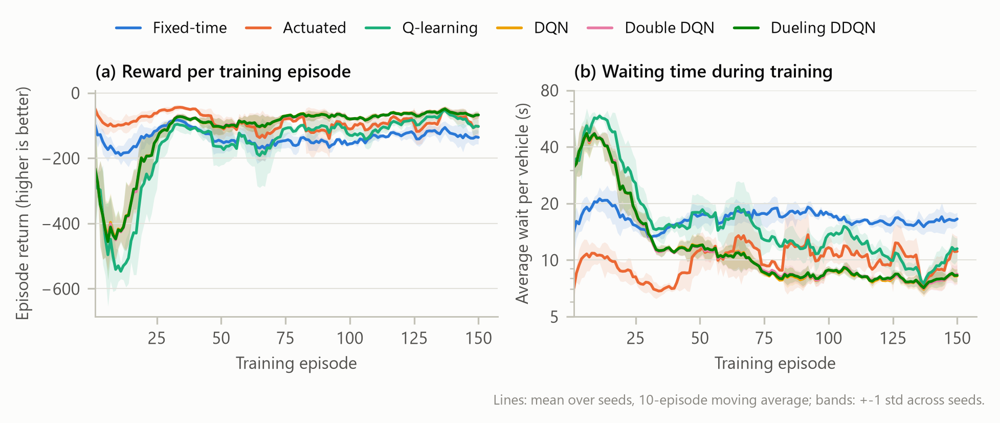
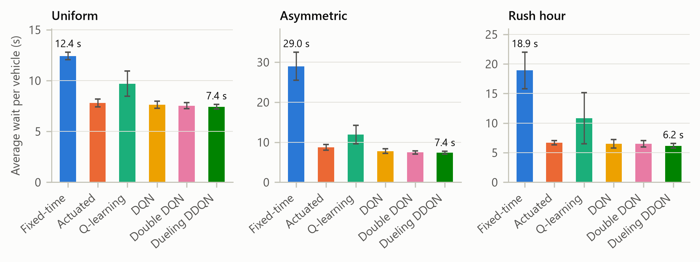
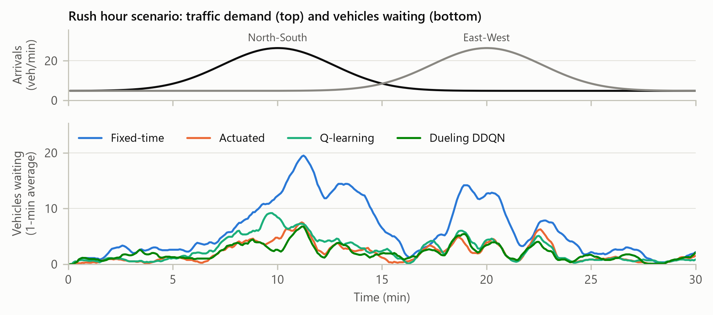
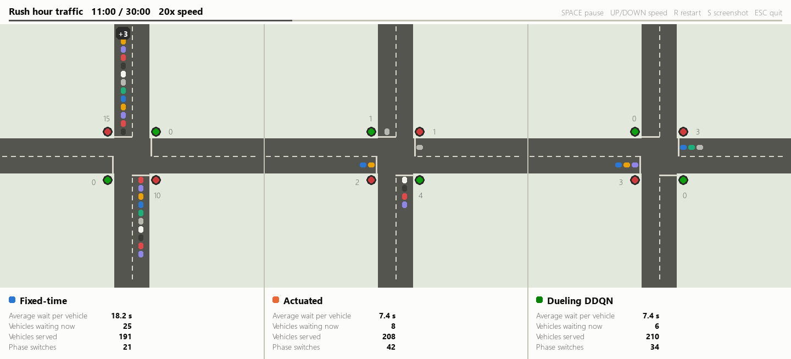

# Adaptive Traffic Signal Control with Deep Reinforcement Learning

Mini project for the Reinforcement Learning course (Final Year B.Tech CSE).

A reinforcement-learning agent learns when to switch the lights at a four-way
intersection so that drivers spend as little time waiting as possible. Four RL
agents (tabular Q-learning, DQN, Double DQN, Dueling Double DQN) are compared
against two conventional controllers (a fixed-time signal and a queue-actuated
signal) on three traffic patterns the agents never saw during training.

## Results

Average waiting time per vehicle on held-out test traffic (lower is better).
Mean +- std over 5 evaluation episodes, and over 3 training seeds for the learning agents.

| Controller | Uniform | Asymmetric | Rush hour |
|---|---|---|---|
| Fixed-time | 12.4 +- 0.4 s | 29.0 +- 3.5 s | 18.9 +- 3.1 s |
| Actuated | 7.8 +- 0.4 s | 8.7 +- 0.7 s | 6.7 +- 0.4 s |
| Q-learning | 9.7 +- 1.2 s | 11.9 +- 2.3 s | 10.8 +- 4.3 s |
| DQN | 7.6 +- 0.3 s | 7.8 +- 0.6 s | 6.5 +- 0.7 s |
| Double DQN | 7.5 +- 0.3 s | 7.5 +- 0.4 s | 6.5 +- 0.6 s |
| **Dueling DDQN** | **7.4 +- 0.2 s** | **7.4 +- 0.4 s** | **6.2 +- 0.4 s** |

Key findings:

- **Dueling Double DQN is the best controller in every scenario.** It cuts average
  waiting time by 40% (uniform), 74% (asymmetric) and 67% (rush hour) compared with the
  fixed-time signal, and by 5%, 15% and 8% compared with the queue-actuated signal.
- The gains are largest when demand is unbalanced: a fixed 30 s / 30 s split wastes
  green time on the quiet road, while the agent gives green time where the queues are.
- Tabular Q-learning beats fixed-time (22-59% less waiting) but not the actuated signal,
  and varies much more between seeds: its coarse table cannot separate situations that
  the neural network distinguishes.
- DQN, Double DQN and Dueling DDQN learn at almost the same rate (their training curves
  overlap because they share seeds, so they see identical traffic and exploration at the
  start); the Double and Dueling extensions give a small but consistent improvement.
- Every controller serves almost the same number of vehicles (the junction is below
  capacity); what differs is how long drivers wait.
- The 60 s max-green safety rule is almost never needed: at most about 2 forced
  switches per 30-minute episode for any RL agent (full tables in `results/summary.md`).






## Setup

Requires Python 3.10 or newer. From this folder:

```bash
python -m venv .venv
```

```bash
.venv\Scripts\python -m pip install -r requirements.txt
```

`pygame-ce` is a drop-in build of pygame (the code still does `import pygame`);
it is used because classic `pygame` has no wheels for Python 3.14. Only the demo
needs it.

All commands below call the virtual environment's Python directly, so there is
no need to activate it (activation is often blocked by PowerShell's execution policy).

## Running

| Step | Command | What it does | Time (CPU) |
|---|---|---|---|
| 1 | `.venv\Scripts\python test_env.py` | Checks the simulator (Gymnasium API, fairness, vehicle conservation, reward = delay) | seconds |
| 2 | `.venv\Scripts\python train.py` | Trains every agent with 3 seeds; saves models and per-episode logs | ~18 min |
| 3 | `.venv\Scripts\python evaluate.py` | Tests all controllers on held-out traffic, writes tables and figures | ~1 min |
| 4 | `.venv\Scripts\python demo.py` | Live side-by-side animation for the viva | - |
| - | `.venv\Scripts\python diagrams.py` | Redraws the architecture and workflow diagrams | seconds |

Trained models are already included in `results/`, so steps 3 and 4 work without retraining.

Useful variations:

```bash
.venv\Scripts\python train.py --agents dqn --seeds 0 --episodes 20
```

```bash
.venv\Scripts\python demo.py --agents fixed_time actuated dueling_ddqn --scenario asymmetric
```

```bash
.venv\Scripts\python demo.py --headless --until 600 --screenshot results/screenshots/rush_hour.png
```

Demo keys: `SPACE` pause, `UP`/`DOWN` speed, `R` restart, `S` screenshot, `ESC` quit.

## The problem as a Markov Decision Process

| Element | Definition |
|---|---|
| Environment | One intersection, four one-lane approaches (N, S, E, W), two phases (North-South green / East-West green). Poisson arrivals; a green lane discharges 0.5 veh/s (1800 veh/h); every phase change costs 3 s of yellow in which nobody moves. 1 s simulation ticks, 30-minute episodes. |
| Safety rule | Maximum green of 60 s: if a phase has lasted 60 s the environment switches it even if the controller asks to extend it, as real signal controllers do. Every controller is subject to it; the number of forced switches is reported. |
| State (7 values) | Queue length of each approach / 40 (clipped to 1), one-hot current phase, time in current phase / 60 s (clipped to 1) |
| Action (2) | Which phase is green for the next 5 s. Choosing the current phase extends it; choosing the other starts a yellow. |
| Reward | -(vehicle-seconds of waiting in the 5 s interval) / 100. The episode return is exactly minus the total delay / 100, so maximising reward minimises waiting time. |
| Discount | gamma = 0.95 |
| Training traffic | A new random demand pattern every episode (random mean rates, lane imbalance and a slow sinusoidal swing between the two directions) |
| Test traffic | `uniform` (0.10 veh/s on every lane), `asymmetric` (main road 0.20, side street 0.06), `rush_hour` (a North-South peak followed by an East-West peak) |

## Controllers compared

| Name | Type | Idea |
|---|---|---|
| Fixed-time | Baseline | Switches every 30 s whatever the traffic (60 s cycle) |
| Actuated | Baseline | After a 10 s minimum green, serves the direction with the longer queue |
| Q-learning | RL, tabular | Q-table over a compressed state: North-South and East-West queue totals (6 bins each) x phase x time in phase (4 bins) = 288 states |
| DQN | Deep RL | 2 x 128 MLP, experience replay (50k), target network (hard update every 1,000 steps), Huber loss |
| Double DQN | Deep RL | DQN + Double-DQN target to reduce Q-value over-estimation |
| Dueling DDQN | Deep RL | Double DQN + dueling value/advantage head |

All hyperparameters are in [config.py](config.py).

## Project structure

```
config.py        every hyperparameter and path
traffic_env.py   intersection simulator (Gymnasium environment)
agents.py        baselines, Q-learning, DQN / Double / Dueling
train.py         training loop, saves models and logs
evaluate.py      held-out evaluation, summary tables
plots.py         report figures
diagrams.py      system-architecture and workflow diagrams
demo.py          pygame live demo and screenshots
test_env.py      simulator sanity checks
report/          RL_Mini_Project_Report.docx and .pdf (fill in the highlighted
                 names in Word, then File > Save As > PDF)
results/
  models/        trained weights (*.pt) and Q-tables (*.npy)
  logs/          per-episode training logs (CSV)
  traces/        queue lengths over one evaluation episode (CSV)
  plots/         figures for the report (PNG)
  screenshots/   demo screenshots (PNG)
  summary.md     result tables (mean +- std), ready to paste into the report
```

## How the files map to the report

| Report section | Source |
|---|---|
| Methodology: algorithm, environment, state/action/reward | this README, `traffic_env.py`, `agents.py` |
| System architecture / workflow diagrams | `results/plots/architecture.png`, `results/plots/workflow.png` |
| Hyperparameters, training strategy | `config.py`, `train.py` |
| Training curves, reward graphs | `results/plots/training_curves.png` |
| Comparison with baselines | `results/summary.md`, `results/plots/eval_avg_wait.png` |
| Performance analysis | `results/plots/rush_hour_queues.png` |
| Screenshots | `results/screenshots/` (from `demo.py`) |

## Limitations

- One isolated intersection with one lane per approach and no turning movements,
  pedestrians or vehicle dynamics (a queue model, not a microscopic simulator such as SUMO).
- Demand patterns are synthetic.
- The state clips queues at 40 vehicles, so the agent cannot tell a queue of 40 from one of 80.

## References

1. V. Mnih et al., "Human-level control through deep reinforcement learning," *Nature*, vol. 518, pp. 529-533, 2015.
2. H. van Hasselt, A. Guez and D. Silver, "Deep reinforcement learning with double Q-learning," in *Proc. AAAI*, 2016.
3. Z. Wang et al., "Dueling network architectures for deep reinforcement learning," in *Proc. ICML*, 2016.
4. C. J. C. H. Watkins and P. Dayan, "Q-learning," *Machine Learning*, vol. 8, pp. 279-292, 1992.
5. H. Wei, G. Zheng, H. Yao and Z. Li, "IntelliLight: A reinforcement learning approach for intelligent traffic light control," in *Proc. KDD*, 2018.
6. R. S. Sutton and A. G. Barto, *Reinforcement Learning: An Introduction*, 2nd ed. MIT Press, 2018.
